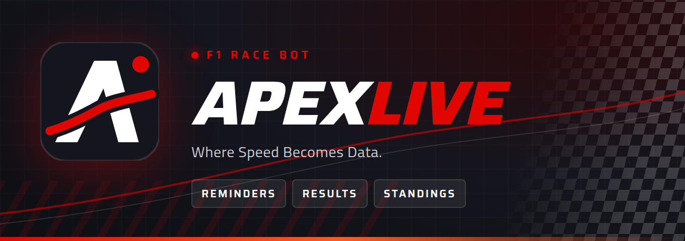

# ApexLive Discord bot



Formula 1 race reminders, results and standings for your Discord server. Companion to the
[ApexLive website](https://thaneshwaraa.github.io/Apexlive/).

**[Add it to your server →](https://thaneshwaraa.github.io/Apexlive/discord/)**

## What it does

**Automatic posts** (after an admin runs `/alerts setup`):

| When | Post |
| --- | --- |
| Race | 1 day, 1 hour and 10 min before, plus "lights out" when it starts |
| Sprint, Qualifying, Sprint Qualifying | 1 hour and 10 min before, plus when it starts |
| Practice (optional) | 10 min before |
| Results | Race, sprint and qualifying classification once published (checked every 5 min) |

Times are shown in IST by default, with a live "in 2 hours" countdown. Set `DISPLAY_TZ` to another
timezone (e.g. `Europe/London`), or to `local` for each reader's own timezone.

**Slash commands**

- `/next`: the next (or live) session and the whole weekend schedule
- `/schedule`: upcoming races, with calendar subscription links
- `/standings [drivers|constructors]`
- `/results [race|sprint|qualifying] [round]`
- `/notify`: join or leave the reminder ping role
- `/alerts setup | status | test | off`: server admins only (Manage Server)

Data comes from [Jolpica-F1](https://github.com/jolpica/jolpica-f1), a free Ergast-compatible API
that needs no key.

## Run your own copy

1. Go to https://discord.com/developers/applications, click **New Application**, open **Bot**, and
   copy the token. The bot needs no privileged intents.
2. Under **OAuth2 → URL Generator**, tick the `bot` and `applications.commands` scopes and the
   permissions **View Channels**, **Send Messages**, **Embed Links** and **Mention Everyone**. Tick
   **Manage Roles** too if you want `/notify`. Open the generated URL to invite the bot.
3. Install and run it (Node 20.12 or newer):

   ```bash
   git clone https://github.com/Thaneshwaraa/Apexlivechatbot.git
   cd Apexlivechatbot
   cp .env.example .env    # put your token in DISCORD_TOKEN
   npm install
   npm start
   ```

4. In your server, run `/alerts setup channel:#f1 role:@F1 Alerts`, then `/alerts test`.

Set `DEV_GUILD_ID` in `.env` to your server's ID while testing, so commands show up immediately.
Global commands can take up to an hour to appear the first time.

For `/notify` to work, the bot's role must be **above** the ping role in Server Settings → Roles.

## Hosting

The bot has to run all the time. Any always-on machine works, such as a small VPS, a Raspberry Pi, or
a host like Railway or Fly.io. To keep it running with pm2:

```bash
npm i -g pm2 && pm2 start npm --name apexlive-bot -- start && pm2 save
```

### bot-hosting.net and other Pterodactyl panels

Run `npm run package`. It creates `apexlive-bot.zip`, which holds `dist/index.js` (the whole bot in
one file), `package.json` and `package-lock.json`. Upload the zip in the panel's **Files** tab and
unarchive it. Then add `DISCORD_TOKEN` in **Environment** (or a `.env` file), set the entry file to
`dist/index.js`, choose Node 20 or newer, and start the server. After a code change, run
`npm run package` again and upload the new `dist/index.js`.

Settings and the list of reminders already sent are saved in `data/state.json`. Keep that file
between restarts. Reminders missed by more than 10 minutes while the bot was offline are skipped,
not posted late.

## Project layout

```
src/
  index.ts       Discord client, command routing
  commands.ts    slash command definitions and handlers
  scheduler.ts   reminder and results jobs
  embeds.ts      message cards
  f1.ts          cached F1 data access
  store.ts       JSON settings / sent-state file
  env.ts         loads .env
  shared/        Jolpica client, session schedule, team registry
assets/          banner and icon for the Developer Portal
```

Unofficial fan project, not associated with Formula 1, the FIA, any team or Discord. F1, FORMULA 1
and related marks are trademarks of Formula One Licensing B.V.
[Terms](https://thaneshwaraa.github.io/Apexlive/discord/terms/) ·
[Privacy](https://thaneshwaraa.github.io/Apexlive/discord/privacy/)
